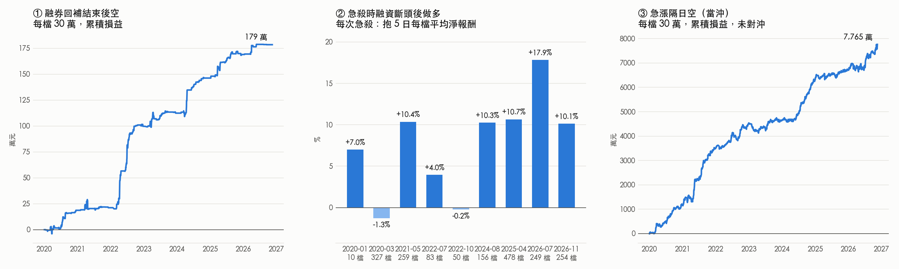

# 被迫的買賣盤結束之後：台股三個反向策略

> 有些買賣不是因為看法，而是因為規則：
> - **融券強制回補**：股東會、除權息前，放空的人必須在期限前把股票買回來
> - **融資斷頭**：維持率跌破 130% 又補不出錢，券商在第三天開盤直接賣掉
> - **追高**：昨天漲很多的股票，隔天早盤有人追進來
>
> 這些買賣盤有期限，做完就沒了。這個專案用 2020-01 ～ 2026-11 的台股上市櫃日資料檢驗：等它結束，反方向做，扣成本後有沒有肉。

**資料**：FinMind 日 K、漲跌停價、融資融券、逐檔融資維持率、暫停融券賣出、當沖標的、處置股、台指期逐筆
**工具**：Python / polars
**狀態**：歷史回測完成；**沒有實盤**。每個策略最大的未知寫在各節最後和「限制」

| | 做法 | 筆數 | 每筆淨報酬 | 勝率 | 逐年 / 逐次 |
|---|---|---|---|---|---|
| ① 融券回補結束後空 | 回補截止日隔天，開盤空、收盤補 | 809 | +74 bp | 61% | 7 年都正，Sharpe 1.88 |
| ② 急殺時融資斷頭後多 | 斷頭隔天開盤買，抱 5 日 | 1,866 | +8.8% | 85% | 9 次急殺 7 次正，最差 −1.3% |
| ③ 急漲隔日空 | 昨日比大盤多漲 ≥2%，開盤空、收盤補 | 117,801 | +22 bp | 59% | 7 年都正，Sharpe 2.30（2023、2025 接近 0） |

（每檔固定 30 萬；Sharpe = 每日損益平均 ÷ 標準差 × √252，沒部位的日子算 0，已扣成本）



---

## 共同設定

- **股票池**：上市櫃普通股（四碼、不含 ETF 與興櫃時期）。
- **報酬**：`收盤 ÷ 當日參考價 − 1`，參考價已處理除權息。
- **部位**：每檔固定 30 萬，不加權、不調參。
- **成本**：手續費 0.1425% × 2 折 × 2 邊 = 5.7 bp；當沖證交稅 15 bp、非當沖 30 bp。
- **鎖漲停**：空單收盤鎖漲停買不回來的，一律補在之後第一個沒鎖的收盤，並改算非當沖成本。
- **因果**：選股只用進場當下已經公布的資料。融資融券、維持率是收盤後公布，所以都是隔天開盤才進場。

---

## ① 融券強制回補結束後空

### 時程（先用融券餘額確認）

以停券起日為 R，看餘額 ≥ 100 張的股票（股東常會 2,463 檔次、除息 1,725 檔次）：

| | R−6 | R−3 | R−1 | R | R+1 ~ R+3 | R+4 |
|---|---|---|---|---|---|---|
| 融券餘額（中位數，R−6 = 100%） | 100% | 74% | 37% | 0.3% | 0% | 8~14% |
| 當天有融券賣出的比例 | 87% | 83% | 79% | 29% | ~0% | 65~72% |

回補買盤集中在 R 之前六天，R 當天買最多；R+1 起三天不能融券賣出，R+4 恢復。

### 規則

- **選股（R−6 收盤就能決定）**：融券餘額 ≥ 100 張，且 融券餘額 ÷ 20 日均量 ≥ 0.2 天。
- **進出場**：R+1 開盤賣、收盤買回。
- **成本 47.2 bp**：手續費 5.7 + 證交稅 30 + 借券費 11.5（假設年化 6%、借 7 天）。

### 結果

融券餘額越大，回補結束後跌越多：

| 融券餘額 ÷ 20 日均量 | 筆數 | R+1 盤中 | 淨 | 勝率 |
|---|---|---|---|---|
| 餘額 < 100 張 | 8,580 | −39 bp | −11 bp | 46% |
| < 0.2 天 | 3,513 | −106 bp | +57 bp | 58% |
| 0.2 ~ 0.5 天 | 611 | −128 bp | +78 bp | 61% |
| 0.5 ~ 1 天 | 167 | −92 bp | +49 bp | 60% |
| ≥ 1 天 | 31 | −175 bp | +128 bp | 65% |

主版本（≥ 0.2 天）809 筆、326 個交易日：

| 年 | 2020 | 2021 | 2022 | 2023 | 2024 | 2025 | 2026 | 全期 |
|---|---|---|---|---|---|---|---|---|
| 累積（萬） | 19 | 3 | 79 | 13 | 34 | 23 | 9 | 179 |
| Sharpe | 1.73 | 0.20 | 3.50 | 1.16 | 2.41 | 1.81 | 1.41 | 1.88 |

- **本來就弱的股票跌更多**：R−6 在 60 日線下的 447 筆淨 +89 bp、勝率 64%；線上的 362 筆 +55 bp、56%。
- **回補期間有漲的比較好**：回補期下跌的 +41 bp，漲 0~10% 的 +94 bp，漲 ≥10% 的 +87 bp（但只有 78 筆，其中 10% 收盤鎖漲停）。
- **事件集中在 3~4 月（股東會）和 6~9 月（除息）**，這幾個月以外幾乎沒訊號。
- **借券費敏感度**：年化 0% → 每筆 +85 bp；10% → +66 bp；20% → +47 bp（Sharpe 1.26）。

### 最大的未知

R+1 當天融券和當沖先賣後買都被暫停，**只能借券**。提前六天選股就是為了留時間去借，但實際借不借得到、費率多少，沒有資料可驗。整個策略七年在每檔 30 萬下只賺 179 萬，容量很小。

---

## ② 大盤急殺時，融資斷頭後做多

### 規則

- **急殺**：全市場等權報酬 3 日累計 ≤ −5%。2020 年以來 34 天、11 次（相隔 ≤10 個交易日算同一次）。
- **斷頭**：當天收盤逐檔融資維持率 < 130%、融資餘額單日減少 ≥ 5%、當日下跌。
- **第一個急殺日不進場**：收到追繳到真正被賣要兩三天，第一天還不是斷頭賣壓。
- **進出場**：隔天開盤買，抱 5 個交易日，收盤賣；同一次急殺每檔只進一次。成本 35.7 bp。

### 逐次結果

| 急殺 | 3 日最深 | 檔數 | 抱 5 日淨 | 勝率 | 5 日內最深回檔（平均） |
|---|---|---|---|---|---|
| 2020-01 | −7.6% | 10 | +7.0% | 90% | +2.6% |
| 2020-03 | −14.1% | 327 | −1.3% | 46% | −10.8% |
| 2021-05 | −10.2% | 259 | +10.4% | 97% | +1.5% |
| 2022-03 | −5.5% | 0 | — | — | — |
| 2022-06 | −6.2% | 83 | +4.0% | 81% | −1.8% |
| 2022-09 | −7.3% | 50 | −0.2% | 50% | −0.8% |
| 2024-08 | −12.1% | 156 | +10.3% | 99% | +4.9% |
| 2025-04 | −23.1% | 478 | +10.7% | 93% | −3.2% |
| 2026-03 | −5.1% | 0 | — | — | — |
| 2026-07 | −7.7% | 249 | +17.9% | 99% | −2.0% |
| 2026-11 | −6.1% | 254 | +10.1% | 93% | +3.6% |

（只有一天的急殺因為「第一天不進場」所以沒有交易）

### 對照

| | 筆數 | 抱 5 日淨 | 勝率 |
|---|---|---|---|
| 主版本 | 1,866 | +8.8% | 85% |
| 其中長期強勢股（過去 240 日漲 ≥30%） | 562 | +13.3% | 93% |
| 其中其餘 | 1,329 | +6.9% | 82% |
| 第一個急殺日也進場 | 1,991 | +6.0% | 77% |
| 只在第一個急殺日進場 | 399 | −5.1% | 44% |
| 同樣的急殺日、當日下跌，但維持率 ≥140% | 4,866 | +2.0% | 59% |
| 同樣的斷頭條件，但不是急殺日 | 797 | +1.0% | 57% |

（強勢與其餘兩列各自取每檔第一次事件，加起來略多於主版本的 1,866）

- **要兩個條件同時成立**：只有急殺沒有斷頭 +2.0%，只有斷頭沒有急殺 +1.0%，兩個都有 +8.8%。
- **長期強勢股被斷頭後彈最多**：本來在漲的股票被大盤拖下來強制賣出，賣壓結束後回得最快。
- **第一天進場是負的**：2020-03 第一天進場的那批 5 日內還要再跌，「只在第一天進場」最差一次是 −24.6%。

### 最大的未知

- **只有 9 次有交易**，「第一天不進場」是從這幾次裡看出來的，靠的是制度解釋（追繳到斷頭要兩三天），不是統計顯著。
- **2020-03 即使跳過第一天，進場後 5 日內平均還要先跌 10.8%，最差一成的個股跌超過 24%**。這個策略的風險就是接到還沒殺完的那一次。
- 維持率 < 130% 的股票本來就是跌最深的，反彈大有一部分只是「跌深反彈」，沒辦法跟「斷頭賣壓結束」完全分開。
- 逐檔維持率是用平均融資成本推估的，不是每個帳戶的真實維持率。

---

## ③ 急漲隔日空（當沖）

### 規則

- **觸發**：昨日個股報酬 − 加權指數報酬 ≥ 2%，且昨日收盤不是漲跌停。
- **可交易**：昨日成交額 ≥ 5,000 萬、不在處置期間、今日可當沖先賣後買。
- **開盤位置**：今日開盤漲幅在 −1% ~ +5%（開低的不追空；開高 ≥5% 容易被鎖漲停）。
- **進出場**：開盤賣、收盤買回，不設停損。成本 20.7 bp。

### 結果

117,801 筆、平均每天 71 檔，每筆淨 +22.0 bp、勝率 58.9%。收盤鎖漲停被迫留倉的占 3.0%，那些每筆 −10.1%。

| 年 | 2020 | 2021 | 2022 | 2023 | 2024 | 2025 | 2026 | 全期 |
|---|---|---|---|---|---|---|---|---|
| 日均損益（萬） | 4.9 | 9.4 | 4.2 | 0.5 | 6.9 | 1.7 | 5.0 | 4.7 |
| Sharpe | 3.30 | 3.66 | 2.57 | 0.31 | 3.74 | 0.95 | 1.68 | 2.30 |
| 最差一日（萬） | −58 | −80 | −65 | −55 | −82 | −246 | −189 | −246 |

### 這個訊號到底貢獻多少

**台股盤中本來就普遍下跌**：同樣可交易的股票，不看訊號，開盤到收盤平均 −25 bp，前一日收盤到開盤 +29 bp。所以「開盤空、收盤補」隨便做都有 4.9 bp 淨報酬，要扣掉這一塊才是訊號的貢獻。

把同樣可交易、同樣開盤位置的股票分六格，看空單每筆淨報酬：

| | 昨日超額 ≤ −2% | −2% ~ 2% | ≥ 2% |
|---|---|---|---|
| 60 日線上 | +3.8 bp | +3.9 bp | **+23.4 bp** |
| 60 日線下 | −19.0 bp | +1.2 bp | **+19.2 bp** |

- **有用的是「昨日急漲」，不是「長期弱勢」**。我原本的假設是長期弱勢的股票突然走強才該空，強勢股不該空；實測強勢股急漲後隔天跌得一樣多。只做弱勢股的話 Sharpe 從 2.30 掉到 1.46。
- 弱勢股的好處只有一個：被鎖漲停留倉的比例低（1.7% 對 3.6%）。
- **反過來做多不成立**：昨日急跌的股票隔天盤中還是跌，開盤買收盤賣每筆約 −45 bp。

### 敏感度（一次只改一個條件）

| 版本 | 筆數 | 每筆淨 | Sharpe |
|---|---|---|---|
| 基準 | 117,801 | 22.0 bp | 2.30 |
| 昨日超額 ≥ 1% | 199,117 | 18.2 bp | 2.22 |
| 昨日超額 ≥ 3% | 70,377 | 25.7 bp | 2.37 |
| 昨日超額 ≥ 5% | 24,937 | 30.2 bp | 2.22 |
| 只做弱勢（60 日線下） | 39,591 | 19.2 bp | 1.46 |
| 不看開盤位置 | 139,958 | 16.1 bp | 1.58 |
| 開盤 −1% ~ +3% | 112,524 | 22.6 bp | 2.41 |
| 開盤 −1% ~ +7% | 119,094 | 21.5 bp | 2.24 |

門檻往哪邊動結果都差不多，唯一明顯有差的是開盤位置：不篩的話 Sharpe 掉到 1.58。

### 台指期對沖：沒有幫助

策略日損益跟台指期盤中報酬的相關係數是 −0.57，等於帶著一個空大盤的部位。同金額做多台指期（09:00 → 13:30，逐筆成交價，2021 年起）：

| 2021 ~ 2026 | Sharpe | 最大回撤 | 最差一日 |
|---|---|---|---|
| 未對沖 | 2.20 | −415 萬 | −246 萬 |
| 台指期對沖 | 2.14 | −356 萬 | −174 萬 |

回撤和最差一日變小，Sharpe 沒有變好。

> **踩過的坑**：一開始用加權指數的「開盤 → 收盤」當對沖腿，Sharpe 從 1.5 跳到 2.6。後來用台指期逐筆重算才發現是假的：加權指數 09:00 的第一個值有一部分還是昨天的收盤價，它的「盤中報酬」跟台指期 09:00 → 13:30 的相關只有 0.80。指數的開盤價不能交易。

### 最大的未知

- **2023 和 2025 幾乎沒賺**，原因還沒找到，換任何條件都一樣。
- 進場價用開盤價。每檔 30 萬在開盤集合競價成交不是問題，但部位放大以後就要算衝擊。
- 每筆只有 22 bp，其中約 5 bp 是盤中普遍下跌。成本假設（手續費 2 折）變差一點，結果就會差很多。

---

## 我原本想的，和資料說的

| 原本的想法 | 資料 |
|---|---|
| 三個策略都要先挑長期弱勢股 | ① 弱勢股確實更好；③ 沒有差別；② 反而是長期強勢股最好 |
| 急漲後會連跌好幾天，可以連空 | 之後幾天的盤中跌幅跟全市場平均一樣，沒有延續 |
| 用指數對沖會讓績效更穩 | 用可交易的台指期價格算，Sharpe 不變 |
| 強勢股急跌隔天可以買 | 盤中做多每筆 −45 bp，不成立 |
| 處置股出關後可以空 | 出關後反而漲（另外測的，沒放進這個 repo） |

## 限制

- 全部是日資料回測，進場價用開盤價、出場價用收盤價，沒有盤中路徑。
- 沒有排除全額交割股（沒有歷史名單）。
- ① 的借券、② 的樣本數（9 次）、③ 的成本假設，各自是該策略成立與否的關鍵，都沒辦法只靠回測回答。
- 三個策略沒有合併成一個資金配置；① 和 ③ 是空方、② 是多方而且只在急殺後出現，理論上互補，但還沒算。

## 重現

```bash
export QUANT_RAW=/path/to/finmind/raw      # FinMind 日資料與台指期逐筆
python code/00_build_panel.py              # 建日頻 panel
python code/00b_tx_intraday.py             # 台指期 09:00 → 13:30
python code/01_surge_fade.py               # ③
python code/02_short_cover.py              # ①
python code/03_margin_call_long.py         # ②
python code/04_figures.py
```

完整輸出在 `results/*.txt`，逐筆與逐日在 `results/*.csv`。原始資料不放進 repo。
